# 🌐 Network Traffic Monitoring & Intrusion Detection using Zeek + Elastic SIEM

Network-level monitoring with **Zeek** as the traffic analyser and **Elastic SIEM** for centralised analysis. The lab captures live traffic, analyses connections, DNS and protocol anomalies, and investigates them SOC-style **without any signature-based IDS rules**.


---

## 📌 Objectives

- Capture live network traffic with Zeek
- Analyse connection, DNS and anomalous behaviour
- Ship Zeek logs to Elastic SIEM and correlate events
- Demonstrate behaviour-based detection instead of signatures

---

## 🏗️ Lab Architecture

```
Windows VM  (traffic generator: browsing, ping, background services)
     │
     ▼
Ubuntu Server 22.04  ──  Zeek (standalone sensor)
     │
     ▼
Filebeat  (ships /opt/zeek/logs/current/*.log)
     │
     ▼
Elasticsearch  ──▶  Kibana (SIEM)        [Elastic Stack on Docker]
```

| Tool | Purpose |
|---|---|
| Zeek 8.0.5 | Network security monitor |
| Filebeat 8.19.10 | Log shipper (Zeek module) |
| Elasticsearch | Log storage & indexing |
| Kibana | Discover / SIEM investigation |
| Ubuntu Server 22.04 | Zeek sensor + forwarder |
| Windows VM | User traffic source |

---

## ⚙️ Setup & Verification

### Zeek
```bash
zeek --version
sudo /opt/zeek/bin/zeekctl status
```
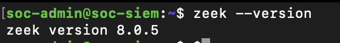
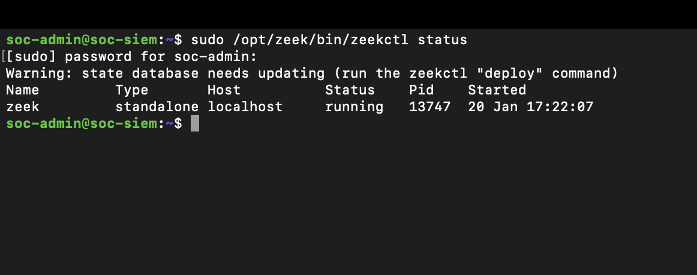

### Zeek logs generated
```bash
sudo ls /opt/zeek/logs/current
```
`conn.log` · `dns.log` · `weird.log` · `notice.log` · `stats.log` · `dhcp.log` · `ntp.log` · `known_services.log`

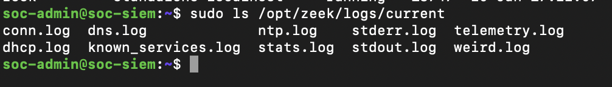

### Filebeat
```bash
filebeat version
sudo systemctl status filebeat
```
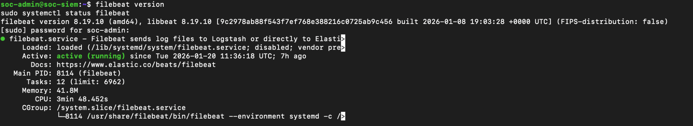

### Elasticsearch ingestion (Kibana Dev Tools)
```
GET _cat/indices?v
```
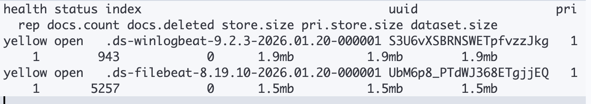

---

## 📡 Zeek Log Analysis

### Connections – `conn.log`
Source/destination IP & port, protocol, duration and connection state for every session.
```bash
sudo tail -n 10 /opt/zeek/logs/current/conn.log
```
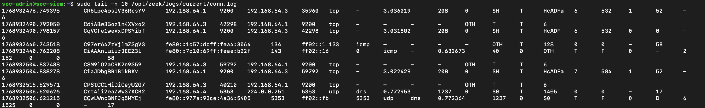

### DNS – `dns.log`
Local hostname resolution, multicast DNS (`.local`) and service discovery traffic.
```bash
sudo tail -n 10 /opt/zeek/logs/current/dns.log
```
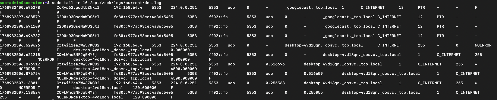

### Anomalies – `weird.log`
Protocol-level behavioural deviations (not signatures).
```bash
sudo tail -n 10 /opt/zeek/logs/current/weird.log
```

| Anomaly | Meaning |
|---|---|
| `data_before_established` | Data sent before the TCP handshake completed |
| `active_connection_reuse` | New SYN seen on a connection that was still active |
| `inappropriate_FIN` | FIN flag seen in an unexpected TCP state |

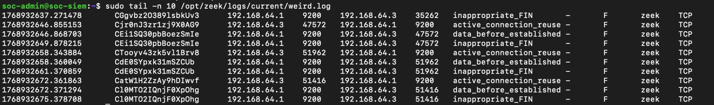

---

## 🔎 Kibana SIEM Investigation (KQL)

| Purpose | Query |
|---|---|
| All network sessions | `event.module:"zeek" and event.dataset:"zeek.connection"` |
| DNS monitoring | `event.module:"zeek" and event.dataset:"zeek.dns"` |
| Intrusion detection events | `event.category:"intrusion_detection"` |

All queries are in [`queries/detection-queries.kql`](queries/detection-queries.kql).

**Network connections (172 hits)**
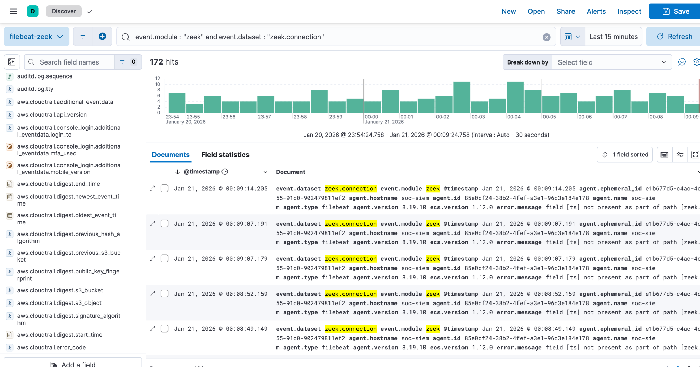

**DNS activity (60 hits)**
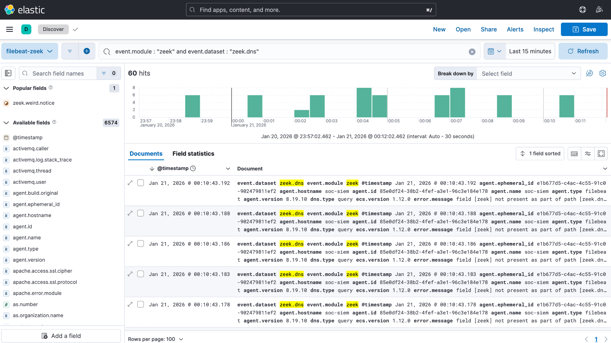

**Intrusion detection event**
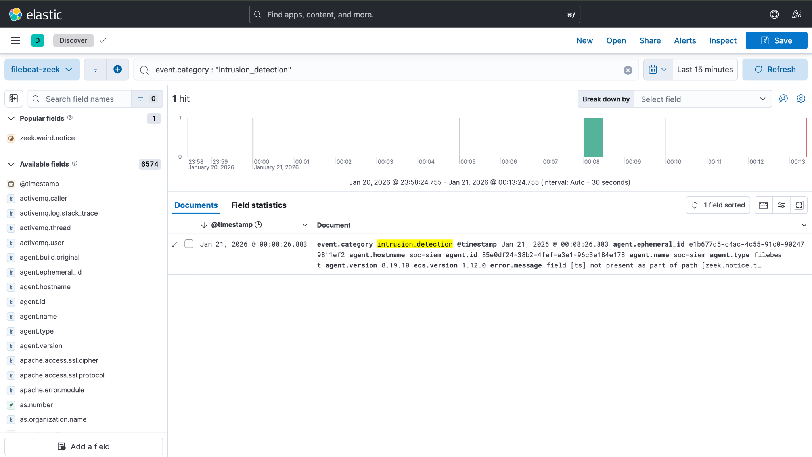

---

## 📊 Key Findings

- Normal user traffic (web browsing, DNS lookups) observed
- Repeated TCP sessions between internal hosts on port 9200 (Elasticsearch)
- Zeek flagged `data_before_established`, `active_connection_reuse` and `inappropriate_FIN`
- At least one event was categorised as `intrusion_detection` in Elastic SIEM
- No signs of malware exploitation, C2 traffic or data exfiltration

**Analysis:** The anomalies are consistent with misordered TCP packets, reused sessions and application behaviour triggering protocol warnings, classified as **benign anomalous traffic**.

**Severity:** Low to Medium · **Status:** Closed

---

## 🛡️ Recommendations (production)

- Investigate repeated TCP anomalies for misconfigured applications
- Correlate network anomalies with host-based logs
- Establish a baseline of normal network behaviour
- Alert on repeated `intrusion_detection` events
- Monitor DNS for suspicious or newly seen domains

---

## 📚 Skills Demonstrated

`Network security monitoring` · `Zeek` · `Filebeat` · `Elastic SIEM` · `KQL` · `TCP/IP analysis` · `DNS analysis` · `Behavioural detection` · `Incident reporting`

---

## 📄 Full Documents

- 📘 [Project Documentation (PDF)](docs/project-documentation.pdf)
- 📝 [Incident Report (PDF)](docs/incident-report.pdf)

> All traffic was generated in an isolated lab on a private IP range.
